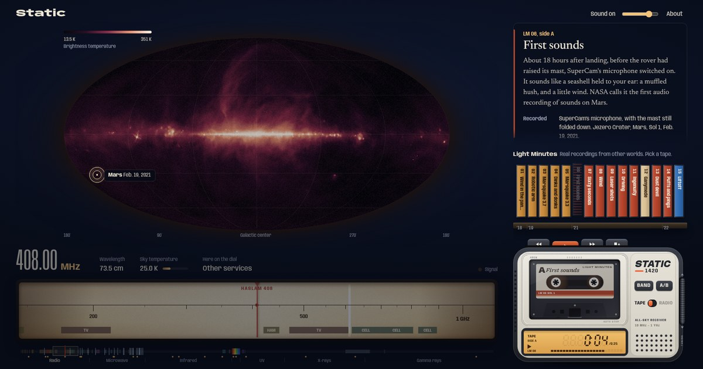

# Static: tune the real sky

A portable radio for the whole sky, and a shelf of tapes recorded on other worlds.

Turn the dial and the whole sky redraws itself as it really looks at that frequency, while the static
rises and falls with how bright that sky actually is. The dial starts at 10 MHz radio waves and keeps
going, through infrared and visible light, to X-rays and gamma rays: 56 octaves of the electromagnetic
spectrum, of which your eyes see less than one.

Twenty-one stations sit on the dial: Jupiter's radio storms, the first pulsar ever found, the hydrogen
line, GPS, the Big Bang's afterglow, and then real all-sky surveys from IRAS, WISE, 2MASS, a photograph of
the whole night sky, GALEX, ROSAT, INTEGRAL and Fermi. Each has a sound you can hear when you lock on.

The tapes are fifteen real recordings published by NASA: the first sounds recorded on Mars, marsquakes,
the Ingenuity helicopter in flight, a dust devil passing over the Perseverance rover, radio from
Jupiter's moon Ganymede, and the Artemis I launch. Click one and it flies into the player. Press play,
and the sky marks where that planet was on the day of the recording.



Up to 5 THz the maps come from GSM2016, a model of the radio sky built from 29 sky maps. Above that,
every station is a real survey image, served by the CDS astronomical data center in Strasbourg.
Nothing on the sky is painted by hand.

---

## Tonight: get it running (2 minutes)

You need Python 3, which macOS and Linux already have. On Windows, install it from python.org or the
Microsoft Store if `py --version` doesn't print a version.

1. Unzip `static.zip` somewhere easy, like your Desktop.
2. Open a terminal in the unzipped `static` folder.
   - **macOS:** open Terminal, type `cd ` (with a space), drag the `static` folder into the window, press Return.
   - **Windows:** open the `static` folder in File Explorer, click the address bar, type `cmd`, press Enter.
3. Start a local web server:
   - macOS / Linux: `python3 -m http.server 8000`
   - Windows: `py -m http.server 8000`
4. Open **http://localhost:8000** in Chrome, Edge, Firefox or Safari. Put on headphones and click **Turn on**.

To stop the server, press `Ctrl+C` in the terminal.

Why a server? Browsers won't let a page opened straight from your files (`file://`) load its own data.
If you double-click `index.html` instead, the page tells you to do this.

## Tonight: put it online (10 minutes)

**First, keep a copy of the survey images with your site (1 minute).** The light half of the dial
fetches nine survey images from the CDS archive. Without this step every visitor's browser downloads
them from CDS; with it, your site serves its own copies, which is faster and kinder to a free
scientific service if your post takes off. In the `static` folder, run:

- macOS / Linux: `python3 tools/fetch_surveys.py`
- Windows: `py tools\fetch_surveys.py`

It needs no extra packages and saves eight images (a few megabytes) into `data/surveys/`. The ninth, Axel
Mellinger's photograph of the night sky, is copyrighted, so it is never copied: the site always shows it
live from CDS, the way other sky viewers do.

**Second, keep a copy of the tapes (2 minutes).** Same idea for the recordings: without this step the
player streams each one from nasa.gov. With it, they start faster and the player's level meter can
follow the sound. In the `static` folder, run:

- macOS / Linux: `python3 tools/fetch_tapes.py`
- Windows: `py tools\fetch_tapes.py`

If you have ffmpeg (`brew install ffmpeg` on a Mac, `winget install ffmpeg` on Windows), the script turns
the recordings into MP3s, about 30 MB for all twenty sides. Without it, it keeps NASA's WAV files, which
are much bigger, and skips any over 50 MB (those sides keep streaming from NASA). Either way it writes
`data/tapes/tapes.json`, which tells the player what's there.

Then pick one. Both are free.

### Option A: Netlify Drop (fastest)

1. Make a free account at **netlify.com** and log in. (Logged-in drops stay up; anonymous ones expire.)
2. Go to **app.netlify.com/drop** and drag the whole `static` folder onto the page.
3. Wait for the upload (about 14 MB, plus the survey images and tapes), then open the link it gives you.
4. Rename it: **Site configuration > Change site name**, for example `static-radio`, which gives you
   `https://static-radio.netlify.app`.

### Option B: GitHub Pages (best for a portfolio: the code and the live site in one place)

1. On github.com, create a new **public** repository called `static`. Don't add a README; this folder has one.
2. In the terminal, inside the `static` folder (replace `YOUR-NAME`):

   ```sh
   git init
   git add .
   git commit -m "Static: tune the real sky"
   git branch -M main
   git remote add origin https://github.com/YOUR-NAME/static.git
   git push -u origin main
   ```

   No terminal? Use GitHub Desktop: **File > Add local repository**, pick the folder, then **Publish
   repository**. (The website's drag-and-drop uploader takes only 100 files at a time, and the sky alone
   is 147, so it's the slow way.)
3. On the repository page: **Settings > Pages**. Under **Build and deployment**, set **Source** to
   **Deploy from a branch**, choose **main** and **/ (root)**, and click **Save**.
4. After a minute or two the site is live at `https://YOUR-NAME.github.io/static/`.

### Then: make link previews work

Social sites need the full address of the preview image. In `index.html`, change

```html
<meta property="og:image" content="assets/og.jpg">
```

to your live address, for example `https://YOUR-NAME.github.io/static/assets/og.jpg`, and upload again
(`git commit -am "Preview image" && git push`, or drag the folder onto Netlify again).

### Before you share it, check

- [ ] It loads on your phone, and sound plays after **Turn on** (on an iPhone that stays quiet, check the silent switch).
- [ ] Tune to 1420.4 MHz: the Hydrogen card appears and the Signal lamp lights.
- [ ] Tune to 160 GHz: the sky turns into the speckled Big Bang map.
- [ ] Press ↑ until you reach WISE, 2MASS and the night sky: real survey images, not static. (If a
      station says it couldn't load, check your connection; running `tools/fetch_surveys.py` makes all but
      the night sky independent of CDS.)
- [ ] Click **LM 06, First sounds** on the shelf: it flies into the player. Press play: you hear Mars,
      the counter runs, and a marker on the sky shows where Mars was on Feb. 19, 2021.
- [ ] Press **Band** on the player a few times: the radio jumps radio, microwave, infrared, visible, UV,
      X-ray, gamma.
- [ ] Copy the address bar and open it in a new tab: it reopens on the same frequency, or with the same
      tape in the player (`#tape=lm06`).

---

## Using it

| | |
|---|---|
| Drag the dial, or roll the player's **tuning wheel** | Tune across the whole spectrum |
| Scroll wheel, or ← → | Small moves (hold Shift for bigger ones) |
| Click a station name, ↑ ↓, or ◀◀ ▶▶ with the player on Radio | Jump between stations |
| **Band** on the player, or click the strip under the dial | Jump to another part of the spectrum |
| Point at the sky | Read the temperature at that spot (radio maps), or its galactic coordinates |
| Click a tape on the shelf | It flies into the player; press ▶ to play |
| ▶, ■ (twice to eject), hold ◀◀ ▶▶ | Play, stop, eject; rewind and fast-forward (cue and review while playing) |
| **A/B** | Turn the tape over: some tapes have a second version on side B |
| **Tape / Radio** switch | Swap between the tape and the radio. Touching the dial brings the radio back. |
| Space | Play or stop the tape |
| M | Mute |

Every frequency has its own link: `…/#f=1420.406` opens on the hydrogen line, `#f=160200` on the
Big Bang, `#f=5.667e8` on visible light. So does every tape: `#tape=lm06` loads the first sounds from
Mars, `#tape=lm15b` side B of the Artemis launch. Handy for posts and for your video.

## What's real, and what's translated

**Real:** every map, every temperature, every wavelength. The radio maps are GSM2016 (Zheng et al. 2017),
rendered by `tools/make_sky.py` straight from the authors' published model data. The static's loudness
follows the median brightness temperature of the whole sky at each frequency, CMB included: about
265,000 K at 10 MHz, 25 K at 408 MHz, 3.6 K at the hydrogen line.

Above 5 THz, each station is a real all-sky survey in HiPS format, the standard sky viewers use. The
browser downloads the survey's low-resolution "Allsky" image and reprojects it into the same galactic
map as the radio sky (`js/hipsproj.js`). That code was checked against a real CDS tile: Orion's belt
stars land within 0.6 arcminutes of where they belong. The colors are the survey teams' own composites;
single-band surveys (H-alpha, GALEX, ROSAT) get a tint. Between surveys you see static, because there
is no all-sky picture there to show.

**Translated:** the station sounds. Spectral lines are slowed down by whole octaves, so their pitch ratios
stay true: the hydrogen line at 1420.4058 MHz, divided by 2²², plays at 338.66 Hz. Survey stations play
a chord of their color channels' real frequencies, slowed the same way (2MASS's three infrared colors
come out at 251, 330 and 436 Hz), each note as loud as that color is bright in the map. The pulsar keeps
CP 1919's real 1.3373-second period. GPS plays the real code of satellite 1, slowed 512 times. Jupiter and
the FM band are synthesized stand-ins, not recordings. You can swap in real recordings: see `audio/README.md`.

**The tapes are real recordings,** exactly as NASA published them on its Sounds from Beyond page. Some
were processed by NASA before release, and each tape's notes say how: InSight's seismometer felt
vibrations rather than sound in the air, so its marsquakes were sped up for human ears; the Ingenuity
recording was filtered down to the helicopter's 84 Hz hum; the Ganymede tape is radio, shifted into
hearing range. The player adds a moment of tape hiss before a recording starts, never over it. The
reels turn the way a cassette's would at 4.76 cm a second, and the level meter reads the recording
itself (when the browser is allowed to: with local copies from `fetch_tapes.py`, always).

The sky marker uses JPL's approximate orbital elements for the planets (Standish and Williams), good to
about an arcminute here: Mars on Feb. 19, 2021 comes out 205 million km from Earth, 11 min 25 s by
radio.

**Simplified:** the band labels on the dial come from the US Table of Frequency Allocations, cut down to
what people recognize. The clear slits in the dial glass are the bands where footnote US246 bans all
transmitters, so astronomers can listen.

Temperatures are Rayleigh–Jeans brightness temperatures, the convention radio astronomers use. That's why
warm dust near 3 THz reads in microkelvins. Above 5 THz the readout switches to the energy of one photon.

## Optional extras

### The real hydrogen map (10 minutes, in your browser)

By default, the Hydrogen station shows the sky at 1420 MHz from GSM2016. To show the hydrogen gas itself,
from the HI4PI survey:

1. Open `tools/hydrogen_colab.ipynb` in Google Colab (colab.research.google.com > **Upload**).
2. **Runtime > Run all**, and upload `tools/make_sky.py` and `data/manifest.json` when asked.
3. Put the downloaded `hi4pi.webp` in `data/special/` and replace `data/manifest.json`.

On macOS or Linux you can run it locally instead: `pip install -r tools/requirements.txt`, then
`python3 tools/make_sky.py hydrogen`.

### A physical knob (Arduino, about 20 minutes)

`hardware/static_knob/static_knob.ino` turns a potentiometer into the tuning dial, and an optional button
into "next station". Wiring is in the comments at the top of the file. Upload it with the Arduino IDE, then
in Chrome or Edge open **About > Connect a knob**. A real knob is great on camera.

### Re-render the sky

The site ships with all 147 maps, so you never need this. To change resolution, frame count or the
stretch: on macOS, Linux or Colab, `pip install -r tools/requirements.txt`, then
`python3 tools/make_sky.py sky`. It downloads the GSM2016 data (about 540 MB) on first run.

## How it's built

No frameworks, no build step: plain HTML, CSS and JavaScript modules.

- `tools/make_sky.py` evaluates GSM2016 at 147 frequencies (log-spaced, plus an exact frame at every
  station) and projects each sky into a Mollweide map in galactic coordinates. An asinh stretch keeps
  both the faint sky and the bright galactic plane readable, and the stretch parameters are saved so the
  site can turn pixel values back into kelvin.
- `js/sky.js` draws the map with WebGL: it blends the two frames around your frequency, colors them with
  a palette that drifts from embers to ice to infrared as you tune, and adds grain that follows the
  sky's loudness.
- `js/data.js` paints a low-resolution preview of every frame instantly, then streams full-resolution
  frames outward from wherever you're tuned.
- `js/surveys.js` lists the survey stations and loads their images (local copies first, then CDS);
  `js/hipsproj.js` and `js/reproject.worker.js` turn each HiPS Allsky image into a galactic Mollweide map
  off the main thread.
- `js/dial.js` is the backlit glass dial: a log-frequency scale, stations, human bands and silent bands.
- `js/audio.js` and `js/synth.js` build every sound live with the Web Audio API.
- `js/player.js` is the tape player: an original design drawn in SVG, with a door that opens in 3D,
  reels and tape packs that follow the recording, a canvas LCD with seven-segment digits, and the radio
  controls. `js/cassette.js` draws the tapes, `js/shelf.js` the shelf, and `js/foley.js` synthesizes the
  clicks, the door and the motor.
- `js/tapes.js` lists the fifteen tapes, with NASA's file for each side; `js/ephem.js` works out where
  Mars or Jupiter was on the day of each recording.
- `js/main.js` runs the tuning physics (drag, fling, magnetic detents at stations), locking, the notes
  panel, the hand-off between tape and radio, and shareable links.

```
index.html            the page
css/style.css         layout and type
js/                   everything that moves (see above)
data/                 147 radio maps, previews, the CMB map, manifest.json, surveys/ and tapes/ (local copies)
fonts/                Anybody and Newsreader (SIL Open Font License)
audio/                optional real recordings
tools/                fetch_surveys.py, fetch_tapes.py, make_sky.py, requirements.txt, hydrogen_colab.ipynb
hardware/             Arduino sketch for a physical knob
```

## Credits

- Sky model: H. Zheng et al. (2017), "An improved model of diffuse galactic radio emission from 10 MHz to
  5 THz", MNRAS 464, 3486. Data and code: github.com/jeffzhen/gsm2016 (MIT License).
- Hydrogen (optional add-on): HI4PI Collaboration (2016), A&A 594, A116.
- Survey images: HiPS served by CDS, Strasbourg (Unistra/CNRS; HiPS under ODbL). IRAS/IRIS:
  Miville-Deschênes & Lagache (2005), NASA/IPAC. AllWISE: NASA/JPL-Caltech/UCLA. 2MASS: University of
  Massachusetts and IPAC/Caltech, NASA, NSF. H-alpha: Finkbeiner (2003), from WHAM, VTSS and SHASSA.
  Night sky: © 2000–2017 Axel Mellinger, all rights reserved, shown live from CDS and not redistributed
  (Mellinger 2009, PASP 121, 1180). GALEX: NASA/Caltech. ROSAT: MPE. INTEGRAL: ESA.
  Fermi: NASA/DOE/Fermi LAT Collaboration.
- Tapes: NASA, "Sounds from Beyond" (nasa.gov/sounds-from-beyond). NASA audio is generally not subject to
  copyright in the United States; each tape carries the credit NASA gives it (NASA/JPL-Caltech, with
  LANL, CNES, CNRS, ISAE-Supaero and others for SuperCam; CNES, IPGP, UKSA, Imperial College London,
  Oxford and ETH for InSight's seismometer; SwRI and the University of Iowa for Juno's Waves). No
  endorsement by NASA is implied, and no NASA logos are used.
- Planet positions: E. M. Standish and J. G. Williams, "Approximate Positions of the Planets", JPL Solar
  System Dynamics.
- Spectrum allocations: NTIA, United States Frequency Allocations, and footnote US246.
- Jupiter's frequency: NASA Radio JOVE.
- Type: Anybody (Etcetera Type Co.) and Newsreader (Production Type), SIL Open Font License; license
  files are in `fonts/`.

Made by Rohan Tucker, 2026.
